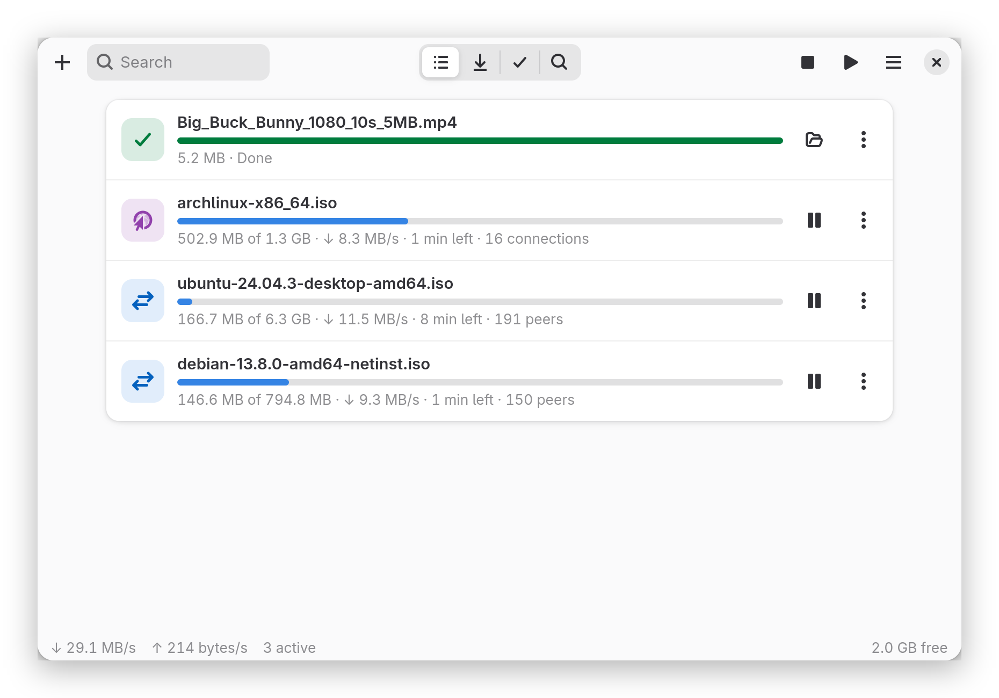

<div align="center">


# Downloader

**A fast, simple torrent and download manager for Linux. Like qBittorrent, minus the 40 columns.**

Torrents, magnet links and direct downloads in one clean list. Built-in search, 16-connection
direct downloads, and you can watch videos while they download.

[](LICENSE)


[](https://github.com/voidrlm/downloader/releases)

[Install](#install) · [Features](#features) · [Watch while downloading](#watch-while-downloading) · [Search](#search) · [FAQ](#faq)



</div>

## Install

Paste this into a terminal:

```sh
curl -fsSL https://raw.githubusercontent.com/voidrlm/downloader/main/install.sh | bash
```

Downloader appears in your app grid and opens magnet links and `.torrent` files from your browser.
The installer adds libtorrent and aria2 (it asks for your password once), installs the app for your user
only in `~/.local/opt/downloader`, and updates it when you run it again.

**Runs on:** Fedora 42+, Ubuntu 25.04+, Debian 13+, Arch Linux and other distributions with libadwaita 1.7 or newer.

<details>
<summary>Other ways to install</summary>

**From a clone:**

```sh
git clone https://github.com/voidrlm/downloader.git
cd downloader && ./install.sh
```

**By hand:** install these, then run `./downloader`. Either engine is optional: without libtorrent you
get direct links only, and without aria2 you get torrents only.

| Distribution | Packages |
|---|---|
| Fedora | `sudo dnf install python3-gobject gtk4 libadwaita rb_libtorrent-python3 aria2` |
| Ubuntu / Debian | `sudo apt install python3-gi gir1.2-gtk-4.0 gir1.2-adw-1 python3-libtorrent aria2` |
| Arch | `sudo pacman -S python-gobject gtk4 libadwaita libtorrent-rasterbar aria2` |

</details>

## Features

- **Torrents and magnet links** with [libtorrent](https://libtorrent.org), the engine qBittorrent uses: DHT, peer exchange, local discovery, UPnP / NAT-PMP, and resume after a restart.
- **Tuned for speed:** announces to every tracker and adds a well-known list of public trackers to each torrent, so downloads find peers quickly.
- **Direct links at full speed:** HTTP, HTTPS and FTP downloads use [aria2](https://aria2.github.io) with up to 16 connections per file, so servers that throttle each connection still give you your full bandwidth. Partial files resume.
- **One list for everything,** with All / Downloading / Finished views, total speed and free space.
- **Easy to add:** paste links with <kbd>Ctrl</kbd>+<kbd>V</kbd> (several at once is fine), drop `.torrent` files or links on the window, or click a magnet link in your browser.
- **Done means done:** finished torrents stop uploading. There's no seeding in the background.
- **Quiet:** no ads, no notifications, no tracking.

## Watch while downloading

Videos in a torrent are downloaded in order, with the start, the end and any subtitle files fetched first.
Press **▶** on a downloading video and it opens in your video player straight away. Seeking works too:
a small streaming server on `127.0.0.1` waits for the pieces you jump to. Works with
[Reel](https://github.com/voidrlm/reel), VLC, mpv, Celluloid and other players, and subtitles are passed along.

## Search

Press <kbd>Ctrl</kbd>+<kbd>F</kbd> or use the search box in the header bar. Results from several public
torrent indexes and the **Internet Archive** are merged and sorted by seeds, and dead torrents are hidden.
Choose which sources to use in **Preferences → Search**. Internet Archive items open a file list for direct
downloads, or download the whole item as a torrent.

## Command line

```sh
downloader "magnet:?xt=urn:btih:…"
downloader https://example.com/big-file.iso
downloader ~/Downloads/something.torrent
```

## FAQ

**Is this legal?**
Downloader is a general-purpose tool, like a web browser. BitTorrent is used every day for Linux
ISOs, game updates and public-domain films. Only download what you have the right to download.

**Where are my files and settings?**
Files go to your Downloads folder; change it in Preferences. Settings are in `~/.config/downloader`,
and the download list and torrent resume data are in `~/.local/share/downloader`.

**It says libtorrent or aria2 is missing.**
Click **Install** in the banner, or install the package for your distribution from the table above.

**How do I uninstall it?**

```sh
curl -fsSL https://raw.githubusercontent.com/voidrlm/downloader/main/install.sh | bash -s -- --uninstall
```

## Contributing

Issues and pull requests are welcome. It's plain Python with no build step: `engines.py` (libtorrent and
aria2, no GTK), `downloader.py` (window), `search.py` / `search_ui.py` (search) and `stream.py` (watch while
downloading). Run `./downloader` from a clone.

If Downloader saves you time, please ⭐ **star the repo**. It helps other people find it.

## License

[MIT](LICENSE)
